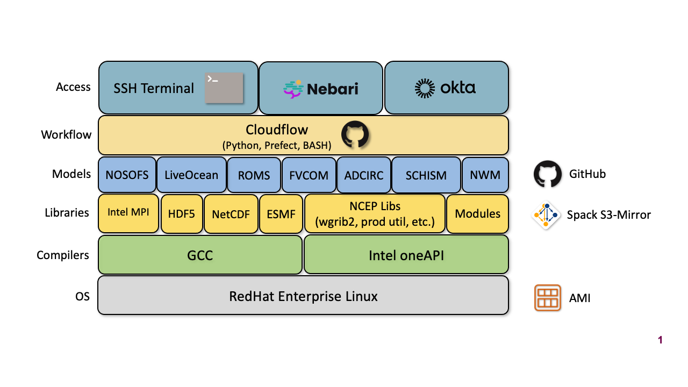

# IOOS Cloud Sandbox

The IOOS Cloud Sandbox is a collaborative platform for running regional
coastal models in the cloud: a head node on AWS, compute nodes started for
each run, the software to build and run the models, and a workflow engine
that runs them. It is used for hindcasts and reanalyses, research to
operations, teaching, on-demand HPC, and quasi-operational fail-over.

This repository holds no code. A sandbox is made of the units below, each
in a repository of its own, at the versions in [units.toml](units.toml).
This repository says which units, which versions, and in which order.

## What a sandbox is made of

| Unit | What it is |
| --- | --- |
| `sandbox-terraform` | The AWS resources: network, security groups, EFS volume, IAM role, placement group, head node |
| `sandbox-provisioning` | Ansible that builds the head node's software (compilers, MPI, Spack, Prefect), the compute-node image, the users, JupyterHub |
| `cloudflow` | The workflow engine that starts compute nodes and runs the models, and the plots of their output |
| `model-common` and eight `model-<name>` units | The recipes that fetch, build and feed each model: ADCIRC (CORA), ECCOFS, LiveOcean, NECOFS, NOSOFS, SECOFS, UCLA ROMS, UFS Coastal |
| `sandbox-configs` | The job and cluster descriptions cloudflow runs with, and their schema |
| `sandbox-ops` | The operator's tools: the Spack mirror, clearing old output, instance changes, the weekly report |



## Building a sandbox, in order

1. **`sandbox-terraform`**, with OpenTofu. Once per AWS account, create the state bucket
   with its `remote-state/` module. Then write the site's settings and
   apply the main module. Its `DEPLOYMENT.md` is the walk-through. It
   names the version of `sandbox-provisioning` the head node applies.
2. **`sandbox-provisioning`.** The head node applies it to itself at its
   first boot (`ansible-pull`, `site.yml`), then makes the compute-node
   image (`node-image.yml`). It takes an hour with the Spack mirror,
   several without. Add users with `users.yml`, and JupyterHub with
   `jupyterhub.yml` if the site wants it. Its `DEPLOYMENT.md` says how to
   follow the installation.
3. **`cloudflow`**, installed on the head node
   in the login user's Python environment.
4. **The models** a site runs: `model-common`, then each `model-<name>`,
   built on the EFS volume under `/save`.
5. **`sandbox-configs`.** A cluster description for each kind of run,
   filled in with what step 1 printed (`key_name`, `sg_ids`, `subnet_id`,
   `placement_group`), the image from step 2 (`image_id`), and the name of
   the DynamoDB table the site made by hand (`table_name`). A job
   description for each run.
6. **Run:** `cloudflow <cluster description> <job description>`.

`sandbox-ops` is used along the way, as needed.

## Integrating a new model

[CLOUD_SANDBOX_MODEL_INTEGRATION_TEMPLATE.md](CLOUD_SANDBOX_MODEL_INTEGRATION_TEMPLATE.md)
is the template for describing a new model to the sandbox. A new model
becomes a `model-<name>` unit and a line in `units.toml`.

## History

Until the split, all of this was one repository. Its README,
`DEPLOYMENT.md`, `TODO` and `.gitignore` are kept as they were under
[history/](history/); their links point into the old layout.

## Working on it

```sh
just test        # units.toml is consistent: names, versions, and the order of the relocations
```

## Licence

BSD 3-Clause; see [LICENSE](LICENSE).
