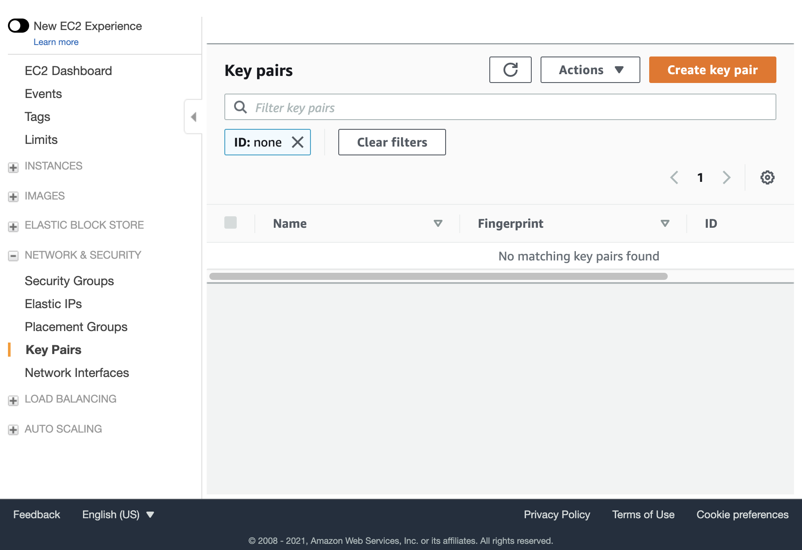

# Deploying the AWS resources of a sandbox

This is the Terraform part of `DEPLOYMENT.md` in the Cloud-Sandbox
repository (its lines 1–183, 209–221, 239–261, 272–274 and 281–304),
written for this project. Installing the software on the head node is the
other part; it is in `sandbox-provisioning`'s `DEPLOYMENT.md`. Where this
text differs from the original, the difference is noted.

OpenTofu, from these Terraform-language modules, creates everything a sandbox needs in an AWS account: the
network (or uses an existing one), the security groups, an EFS volume, an
IAM role, a placement group and the head node. When the head node first
boots it mounts the EFS volume and installs the software.

## Before you start

On your local machine:

- The AWS CLI, configured for your account:
  <https://docs.aws.amazon.com/cli/latest/userguide/install-cliv2.html> and
  <https://docs.aws.amazon.com/cli/latest/userguide/cli-configure-quickstart.html#cli-configure-quickstart-config>.
- AWS credentials with the permissions to create the resources above.
  The owner of the account, or anyone with full administrative rights,
  has them; otherwise ask the account's administrator.
- OpenTofu 1.13.9, the operator's choice (2026-11-13), from
  <https://opentofu.org/docs/intro/install/>. This project's `just init`
  also puts that version in `.tofu/` for its own tests.

  **Differs from the original:** the original asks for Terraform 1.5.7,
  the last Terraform under an open-source licence (later ones are under
  the Business Source Licence). OpenTofu is the open-source fork, under
  MPL 2.0, and reads the same files. A sandbox deployed with Terraform
  1.5.7 can be taken over: OpenTofu reads its state. Once OpenTofu has
  written the state, keep using OpenTofu, and nothing older than the
  version that last wrote it. A `.terraform.lock.hcl` written by Terraform
  records HashiCorp's builds of the providers, which are not byte for
  byte OpenTofu's; run `tofu init -upgrade` once to record OpenTofu's.

  Each module's `versions.tofu` requires exactly 1.13.9, so another
  OpenTofu version stops at `tofu init`. Terraform does not read `.tofu`
  files and is not stopped: use OpenTofu.

- This project: clone its repository (in Cloud-Sandbox it is the
  `terraform/` directory).

AWS allows five VPCs per region by default. If the account has reached
that, either ask AWS for a higher quota or give OpenTofu an existing VPC,
subnet and security groups in the settings file.

## 1. Create the state bucket (once per AWS account)

OpenTofu keeps the state of what it has created in an S3 bucket. The
`remote-state/` module creates that bucket. **Do this only once per AWS
account.**

```sh
cd remote-state
# Edit s3.defaults.tfvars and give the bucket a name no one else uses.
tofu init
tofu apply -var-file=s3.defaults.tfvars
```

A different `.tfvars` file overrides the defaults. If your local files are
lost, the state can be read back from this bucket (step 7).

## 2. Initialise the main module

Make sure the bucket name in `config.s3.tfbackend` is the one from step 1,
then, at the top of the project:

```sh
tofu init -backend-config=config.s3.tfbackend
```

The backend file gives the region and the bucket. To move to another
backend later:

```sh
tofu init -reconfigure -backend-config=alternate.s3.tfbackend
```

### Workspaces

When several people deploy sandboxes in one AWS account, each should work
in a workspace of their own:

```sh
tofu workspace new my_workspace
tofu workspace list
tofu workspace select existing_workspace
```

An overview of workspaces: <https://spacelift.io/blog/terraform-workspaces>.

## 3. Make a key pair

The head node is reached with SSH, so the module needs a key pair that
exists already: an existing one, or one made now.

In the AWS EC2 console: "Key Pairs" under "Network & Security", then
"Create key pair". **Keep the private key somewhere safe.**



With the AWS CLI (`--region` is optional):

```sh
aws --region us-east-2 ec2 create-key-pair --key-name your-key-pair \
    --query KeyMaterial --output text > your-key-pair.pem
chmod 600 your-key-pair.pem
```

The public key, which the settings file needs:

```sh
ssh-keygen -y -f your-key-pair.pem
```

## 4. Write the settings

Edit `mysettings.tfvars`. It holds placeholders; replace them:

| Variable | Value | What it is |
| --- | --- | --- |
| `allowed_ssh_cidr_list` | `["your public IPv4 address/32", ...]` | Where SSH is allowed from. Find your address at <https://www.whatismyip.com/> |
| `key_name` | `"your-key-pair"` | The key pair from step 3 |
| `public_key` | `"ssh-rsa ..."` | The public key from step 3. The module accepts only RSA keys: the value must start with `ssh-rsa ` |
| `vpc_id` | `"vpc-..."` | Optional: an existing VPC to use |
| `subnet_id` | `"subnet-..."` | Optional: an existing subnet to use |

**Differs from the original:** the original names a single
`allowed_ssh_cidr`. The module now takes a list, `allowed_ssh_cidr_list`;
the single variable is commented out in `variables.tf`.

Optional settings, with their defaults:

| Variable | Default | What it is |
| --- | --- | --- |
| `preferred_region` | `"us-east-2"` | The AWS region |
| `name_tag` | `"IOOS Cloud Sandbox Terraform"` | The head node's `Name` tag |
| `nameprefix` | `"ioos_cloud_sandbox"` | Put in front of the names of the resources |
| `project_tag` | `"IOOS-Cloud-Sandbox"` | The `Project` tag of the resources |
| `availability_zone` | `"us-east-2a"` | The availability zone |
| `instance_type` | `"t3.medium"` | The head node's instance type during set-up |
| `use_efa` | `false` | Whether to use the [Elastic Fabric Adapter](https://aws.amazon.com/hpc/efa/) |

## 5. Create the resources

```sh
tofu plan -var-file=mysettings.tfvars -out=my.plan
tofu apply my.plan
```

(or `tofu apply -var-file=mysettings.tfvars` and answer `yes`).

If more than one sandbox has been deployed in the account, the apply can
fail with:

```text
Error: error creating IAM Role (ioos_cloud_sandbox_terraform_role): EntityAlreadyExists
```

Give `nameprefix` a value of its own and apply again.

When the apply finishes, OpenTofu prints how to reach the head node, and
`tofu output` prints it again at any time:

```text
instance_id = "i-01346de00e778f"
instance_public_dns = "ec2-3-219-217-151.compute-1.amazonaws.com"
instance_public_ip = "3.219.217.151"
login_command = "ssh -i ~/.ssh/my-sandbox-key.pem ec2-user@3.219.217.151"
```

(The original's example logs in as `centos`; the module now gives
`ec2-user`, with the key looked for in `~/.ssh/`.)

`./login` runs that login command. Wait a minute or two after the apply:
the instance has to boot. The software installation starts on the head
node at its first boot and goes on after OpenTofu has finished; see
`sandbox-provisioning`'s `DEPLOYMENT.md` for following it.

### What a cluster description needs from here

The module writes `deployment_info.txt` and copies it to the head node, with
the values a cluster description for cloudflow needs:

```text
"key_name"        : "ioos-sandbox",
"image_id"        : "found at the end of setup.log, or provided by admin"
"sg_ids"          : [ "sg-...", "sg-...", "sg-..." ],
"subnet_id"       : "subnet-...",
"placement_group" : "<nameprefix>-..._Terraform_Placement_Group"
```

`image_id` is not the module's: it is the compute-node image made on the
head node after the installation. The DynamoDB table that a cluster
description also names is made by hand and is part of the site's
configuration.

## 6. Afterwards

**A smaller head node.** Once everything is set up, the head node can run
on a smaller instance type. Change `instance_type` in
`mysettings.tfvars` (for example `"t3.micro"`) and apply:

```sh
tofu apply -refresh-only -var-file=mysettings.tfvars
```

If OpenTofu says the instance must be destroyed first, answer `no` to
keep it; `sandbox-ops`' `change-instance-type.sh` is another way.

**Removing the sandbox.** Every resource, the disks included, goes with:

```sh
tofu destroy -var-file=mysettings.tfvars
```

**Save any data you need to S3 or another backup first.**

## 7. Recovering the state

If the local files are lost, or you work from more than one
copy, run `tofu init -backend-config=config.s3.tfbackend` again,
select your workspace with `tofu workspace select`, and run
`tofu plan`: it should find nothing to create.

---

The original is © 2026 Tetra Tech, Inc.; see [LICENSE](LICENSE).
